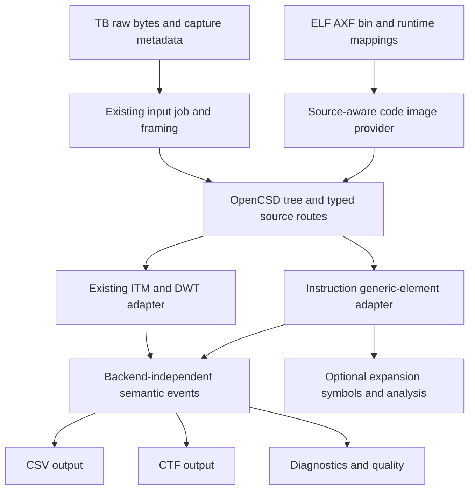

# Instruction Trace Implementation Plan

Status: minimal implementation agreed as the starting scope; broader design remains a working draft.
The proposed CSV extension is local to this plan and is not yet part of the published CMSIS contract.
Research date: 2026-10-28. Baseline: devtools `17f8f54a`, branch `feat/ctrace-instruction-trace`.
OpenCSD baseline: **v1.8.3**, commit `59f15320637ce6e510604e7bed550d7ad109d15d`.

This document separates verified library behavior, ctrace implementation gaps, and proposed decisions.
It describes offline decoding of captured files. Target configuration and capture remain producer responsibilities.
The separate ITM-channel-0 change is not part of this branch.

## 1. Findings and proposed direction

Instruction trace requires more than enabling another OpenCSD decoder for a `.raw` file:

1. Identify the protocol and capture-time decoder configuration for every trace source.
2. Supply the actual executable code bytes at their execution addresses.
3. Consume OpenCSD generic instruction ranges, context, exceptions, time information, and discontinuities.
4. Define a semantic event model and an output contract that can retain this information.

**OpenCSD already contains the instruction decoder needed for program-flow reconstruction.** A separate instruction
codec is not required for that task. An ELF/AXF reader and an address-aware image provider are needed if executable
files are the image source; raw binary images with explicit mappings are another valid input. Assembly text,
symbols, source lines, call graphs, and coverage are separate processing layers. [O2][O3][O4][O5]

Start with the minimal implementation in section 1.1. The reference capture and its exact protocol still need to
be selected; a verified Cortex-M ETMv4 instruction-only capture from M7 or M33 is the preferred candidate.
Mixed ITM/ETM routing, additional protocols, ELF/AXF support and richer outputs belong to subsequent milestones.
Treat MTB as a separate decoder project. Qualify Armv8.1-M support by feature and test evidence rather than
advertising all M52/M55/M85 captures as supported.

### 1.1 Minimal implementation — agreed starting point

The first deliverable decodes **one recorded instruction-trace input, one known ETM protocol and one CPU** to CSV.
Use one matching static binary image at an explicit execution address. Emit one row per decoded instruction range,
with observable gaps and missing-code conditions. This is the starting scope agreed on 2026-10-28.

```text
RAW -> existing framing -> OpenCSD ETM full decoder -> instruction-range event -> CSV
                                      ^
                         matching binary code bytes
```

Reuse the existing input convention, for example `Board.TB.raw` with `Board.ctrace-run.yml` in a trace directory.
A freely named `trace.raw` is not currently a standalone CLI input. Adding direct-file CLI support is a later option.
The buffer must already contain valid bytes in chronological order with known framing. [C8]

The necessary inputs are the actual decoder configuration, architecture/profile, source Trace ID where formatted,
and the matching `.bin` with its execution mapping. A RAW file alone does not establish these facts. Agree the
minimal metadata fields against the first capture; do not infer missing configuration or code bytes.

Implement these five connected extensions:

1. **ETM configuration and route:** extend `TraceRunConfig`, `YmlTraceRunConfigReader` and `CtraceRunMeta` to retain
   one ETM source, its decoder configuration and the binary-image mapping. ETM metadata is currently ignored. [C2][C4]
2. **Code-memory access:** attach a binary file/region accessor to the OpenCSD tree, supplying the actual bytes at
   execution addresses. One static mapping is sufficient for this milestone. An ELF/AXF reader is not required. [O4]
3. **ETM decoder path:** create the selected ETM full decoder and connect it through `DecodePipeline` and
   `FileDecodeJob`. Reuse bounded RAW reads, compatible deformatting and the existing tree lifecycle; keep ITM-specific
   packet monitoring, recovery and timestamp accumulation out of the ETM path. [C3][C9]
4. **Instruction-element adapter:** consume `INSTR_RANGE` and the state needed to interpret it. The current collector
   accepts only `ITMTRACE`. Preserve range/count/execution flags and expose synchronization loss, missing code and
   unsupported context transitions; retain valid partial output. [C3][O3]
5. **Events, selection and CSV:** add an instruction-range payload to `TraceEvent`, a selectable event type and its
   `CsvRowMapper` mapping. Shared event visitors, including CTF, must handle the added variant; instruction CTF
   requests must report unsupported output until that backend is implemented. [C5][C6][C10]

The minimal CSV extension retains the existing eight columns and introduces `type=instr_range`:

```csv
cycles,stream,type,index,value,pc,address,note
,18,instr_range,,,0x08000100,0x08000108,"count=3; isa=T32; last_executed=1"
```

- `stream`: source Trace ID for this formatted example; preserve existing unformatted stream conventions.
- `pc`: range start; `address`: exclusive range end.
- `note`: instruction count, ISA and last-instruction execution flag; retain additional validity/flow flags as needed.
- `index` and `value`: empty for this record type.
- `cycles`: empty without qualified cycle information. Row order preserves decoded order; no synthetic time is added.

This is the agreed initial mapping for implementation, not an existing specification claim. Document its type-specific
semantics and diagnostic mapping before exposing it. Existing ITM/DWT row meanings remain unchanged.
The count describes represented instructions; execution flags still govern whether the last instruction executed.

Completion evidence is an actual capture with complete configuration, matching bytes and independently expected
ranges; correct handling of missing code and synchronization gaps; chunk-boundary-independent results; and unchanged
existing ITM/DWT CSV behavior. The first capture must fit the declared static image/context scope; report unsupported
transitions instead of silently claiming a complete path.

Subsequent work includes ELF/AXF parsing, assembly text, symbols/DWARF, full context output, additional protocols,
mixed sources/multiple CPUs, time correlation, CTF, coverage and call-graph analysis. OpenCSD's existing instruction
decoder supplies flow decoding for the first milestone; no additional instruction-codec dependency is needed.

## 2. OpenCSD support and its limits

### 2.1 Trace protocols

The pinned README and decoder implementations establish the following support. A protocol being implemented
does not establish correct decoding of every processor, trace option, or instruction extension. [O1][O6]

| Trace source | OpenCSD v1.8.3 | Consequence for ctrace |
| --- | --- | --- |
| ETMv3 instructions | Full decode, through v3.5 | M3/M4 candidate; qualify M23. |
| ETMv3 data | Packet processing only | Full decoder rejects data and mixed instruction/data modes. |
| ETMv4 instructions | Full decode; v4.6 A/R, v4.4 M advertised | Main candidate; qualify actual features. |
| ETMv4 data | Packet processing/decode are future work | Outside initial scope. |
| PTM v1.1 | Full instruction decode | Future A-profile extension. |
| ETE v1.3 | Full instruction decode | Future processor-trace extension. |
| ITM v1.0, STM v1.1 | Full software-trace decode | Not an executed instruction path. |
| MTB | No built-in decoder | Separate record decoder and input contract. |
| Earlier ETMv1/v2 | No built-in decoder registered | Generic ETM naming does not establish support. |

OpenCSD supports both packet-processing-only and full-decode configurations. Packet inspection can work without
code images; the desired reconstructed instruction path generally cannot. All decoder families are present in
the OpenCSD source dependency; ctrace currently instantiates only ITM. [O2][O6]

ETMv3 full decode explicitly accepts only instruction-only mode. A capture configured for combined instruction/data
trace is not handled by simply ignoring its data packets. [O11]

### 2.2 Cortex-M architecture and trace-source mapping

The architecture generation and the trace-protocol generation are different axes. The physical device must
actually implement the optional trace source and a usable capture path. A processor name alone is insufficient
decoder configuration. The following matrix is a planning guide, not a device support declaration. [A1][A2][A3]

| Architecture / processor examples | Relevant instruction-trace source | Assessment for this OpenCSD baseline |
| --- | --- | --- |
| Armv6-M: M0, M1 | No ETM path established here | ISA alone does not establish trace support. |
| Armv6-M: M0+ | Optional MTB [A10] | No built-in MTB decoder. |
| v7-M / v7E-M: M3, M4 | Optional ETMv3 | Protocol implemented; qualify captures/exceptions. |
| Armv7E-M: M7 | ETM-M7, ETMv4 | Upstream M7 fixture exists. |
| v8-M Baseline: M23 | ETM-M23: **ETMv3.5**; or MTB | OpenCSD compatibility risk; see below. |
| v8-M Mainline: M33 | ETM-M33 r0p2: **ETMv4.2** | Within advertised scope; M33-profile fixture exists. |
| v8-M Mainline: M35P | Optional ETMv4.2 / MTB | Protocol within advertised scope; qualify captures. |
| Armv8.1-M: M55, M85 | ETM-M55/M85 r1p1: **ETMv4.5** | Partial evidence; not complete qualification. |
| Armv8.1-M: M52 | ETM-M52 r0p2: **ETMv4.5** | Same Armv8.1-M qualification gate. |

The M7 mapping is confirmed by ETM-M7 TRM DDI0494D, PDF p.7, and by an upstream snapshot.
ETM-M23 TRM DDI0563C confirms ETMv3.5 on PDF p.11 and p.20. ETM-M55 TRM
101053_0101_03_en and ETM-M85 TRM 101926_0101_07_en identify ETMv4.5 on PDF p.14.
ETM-M33 TRM 100232_0002_06_en identifies ETMv4.2 on PDF p.7. Its OpenCSD snapshot labels the device `ETM4.4`;
that test metadata is not evidence that ETM-M33 hardware implements v4.4.
Arm's M35P introduction identifies ETMv4.2 on PDF p.15; ETM-M52 TRM 102774_0002_05_en identifies ETMv4.5
on PDF p.14. [A2][A3][A4][A5][A7][A8][A9][O7]

Two specific OpenCSD gaps affect the design:

- **M23:** `EtmV3Config::isV7MArch()` requires exactly `ARCH_V7` and `profile_CortexM`. The ETMv3 packet processor
  uses this check in M-profile exception handling, whereas the processor-name map associates M23 with `ARCH_V8`.
  This is a concrete compatibility risk, not proof that all M23 trace fails. Require M23 exception/security fixtures
  and an upstream assessment. Do not misdeclare M23 as Armv7 to bypass the check. [O8][O12][O13]
- **Armv8.1-M:** the README explicitly leaves M-class branch-forward instruction support as future work.
  There is already an `armv8_1m_branches` M55 snapshot and Thumb code for low-overhead loops, so support is not
  simply absent. Equally, that fixture does not establish complete Armv8.1-M support. A separate disassembler
  cannot automatically repair missing OpenCSD path-reconstruction semantics. [O1][O7][O9]

## 3. Required input: capture, configuration, and code

### 3.1 Trace-buffer bytes

Existing discovery already accepts `<solution-set>.TB.raw` and `<solution-set>.TB_<name>.raw`.
The extension `.raw` and the channel name identify a captured input, not its protocol. A buffer can contain
formatted ETM, mixed ETM/ITM, an unformatted single source, or MTB records. [C1]

For formatter-based captures, the producer must export the valid bytes in chronological order. A raw memory dump
of a circular buffer is insufficient if its write pointer, wrap state, valid length, or alignment is unknown.
The producer must either normalize the buffer or provide enough metadata to do so before deformatting.
Document padding and flush behavior; do not decode unwritten capacity as trace.

The current ctrace transport accepts 16-byte memory-aligned CoreSight frames, without FSYNC/HSYNC framing.
That is reusable for compatible ETB/ETF/ETR-style exports. Other framing modes require an explicit contract.
The current `TB => formatted` default must not cause an MTB byte array to enter the CoreSight deformatter. [C1][O2]

### 3.2 Source configuration

Each source needs a stable source-instance identity, processor association, protocol/revision, architecture/profile,
and an architectural ATB Trace ID when formatted. Unformatted input still needs an explicit source/protocol binding.
Trace ID identifies the source within an input; it is neither an ITM stimulus channel nor a universal CPU number.

The public OpenCSD configuration structures require the following fields. These names describe software API
inputs, not proposed new YAML keys or instructions to program target registers. [O10]

| Decoder family | OpenCSD configuration inputs |
| --- | --- |
| ETMv3 | `reg_idr`, `reg_ctrl`, `reg_ccer`, `reg_trc_id`, `arch_ver`, `core_prof` |
| ETMv4I | IDR0/1/2/8–13, CONFIGR, TRACEIDR, architecture/profile |
| ETE, future scope | IDR0/1/2/8, DEVARCH, CONFIGR, TRACEIDR, architecture/profile |

The latter two rows abbreviate register-backed API fields with their register names; see the complete structures
for their `reg_` field names. ETMv3 and ETE have separate configuration structures. [O14][O15]

The producer must distinguish unavailable fields from valid zero values. Determine required/unused fields for the
selected decoder configuration explicitly. A list of masked register writes is not necessarily a complete decoder
snapshot: identification registers and the resulting active configuration may be absent.

The current CMSIS `instructions:` intent and `ctrace-refs` do not by themselves supply this complete contract.
ctrace does not currently retain ETM references, their register state, or code-image descriptions.
Agree ownership with the debugger/pyTS producer before inventing a ctrace-private schema. [C2][A6]

### 3.3 Executable images

Full instruction decode combines compressed trace with code bytes. Direct branches and sequential instructions
are reconstructed from those bytes; the trace is not a recording of every instruction opcode. [O2][O3]

Every image mapping must identify:

- File/snapshot identity and preferably a capture-time content hash or build identity.
- Processor/source association and Secure/Non-secure address space where applicable.
- Execution address range, file offset and available file-backed length.
- Any explicit relocation, RAM execution mapping, ROM alias, or time-dependent overlay.

The minimal milestone uses one static binary mapping and a capture within that supported execution context.
For broader captures, include bootloader, application, Secure/Non-secure firmware, and required ROM code when crossed.
A valid ELF with the wrong build can produce plausible but incorrect reconstruction. Source symbols alone do not
provide the code bytes. Modified RAM code, software breakpoint patches, or dynamically generated code require
matching capture-time bytes or a documented limitation.

## 4. ELF/AXF reader and instruction decoder responsibilities

### 4.1 What ctrace needs

The first milestone uses raw `.bin` plus an explicit execution address; OpenCSD can access it without an ELF parser.
For a later ELF/AXF milestone, ctrace needs a **read-only image reader**, not a target programmer or dynamic linker.
Detect the format from its contents. The proposed first ELF support is validated ELF32 Arm `ET_EXEC` images and
file-backed load regions at execution VMAs. A stripped executable can be sufficient; symbols and DWARF are optional.
The ELF-specific rules below apply to that later milestone. [E1][E2]

Use program-header file offsets and `p_filesz` to expose actual bytes, mapped to the execution address `p_vaddr`.
Do not use flash load address / `p_paddr` as a universal substitute for where the processor executes RAM code.
Validate toolchain-specific AXF/scatter-loading behavior with fixtures; any section-based fallback must be specified.
Do not synthesize missing instruction bytes from `p_memsz`, BSS, or gaps. Reject ambiguous overlaps, unsupported
relocations, and address arithmetic outside the supported domain. An initial implementation can reject `ET_REL`
and dynamically relocated images until their mapping contract is defined.

No reusable ELF/DWARF reader was found in the current ctrace/devtools C++ path. The implementation decision remains
open between a bounded reader and a portable library. ELFIO is a candidate to evaluate: it is header-only C++ with
an MIT license. Review a pinned version, validation behavior, footprint, and all release platforms before adoption.
A full LLVM dependency is not justified solely by the need to extract ELF code regions. [E3]

#### 4.1.1 ELFIO licensing and distribution

ELFIO uses the MIT license. It can be included in an Apache-2.0 project; the Apache Software Foundation explicitly
lists MIT as a Category A license accepted in its products. Our ctrace code and wrapper can remain Apache-2.0;
retain the MIT license and attribution for the ELFIO portions. [L1][L2]

When integrating ELFIO:

- Preserve upstream copyright and license notices in the imported headers.
- Include the complete upstream MIT license text, including copyright and warranty disclaimer, in distributed
  source packages and binary release packages containing ELFIO code. Use the license from the pinned version.
- Include those notices with binaries even though ELFIO is header-only and has no separately linked library file.
  A website link alone is not a substitute for shipping the notices. [L1]

MIT does not require publication of our source code or modifications, and does not require a file specifically
named `NOTICE`. A practical integration is an ELFIO entry in the third-party component overview plus its original
license in the package's license directory, for example `licenses/ELFIO.txt`. The filename is a packaging choice;
the required notice content must reach recipients. Existing Apache-2.0 license and NOTICE obligations continue
to apply independently. [L1][L3]

Before distributing a build using ELFIO, verify that the source archive and every platform's binary package contain
its license and attribution. This is a condition of the later ELFIO integration; it adds no dependency to the minimal
binary-image milestone.

### 4.2 Connecting images to OpenCSD

OpenCSD offers buffers, binary files, file regions, and callback accessors. File-region access maps a file offset
to an execution start address and length; OpenCSD does not interpret the ELF container for the client. [O2][O4]

For the minimal single-CPU/static-image milestone, a binary file/region accessor is sufficient.
For the later multi-source design, prefer an image provider behind the Trace-ID-aware callback:

```text
DecodeTree::addCallbackIDMemAcc(...)
    -> read(address, memory_space, trace_id, requested_length)
    -> resolve input/source -> processor -> matching image region
    -> return available code bytes and actual byte count
```

The equivalent C API is `ocsd_dt_add_callback_trcid_mem_acc`. Return a short read or zero for inaccessible bytes;
do not supply fabricated opcodes. Keep backing storage alive for the decode session.

The built-in mapper is global: it does not select images by CPU/Trace ID and rejects conflicting mappings in the
same memory space. Distinct cores can execute different images at identical VMAs. Therefore a single collection
of overlapping global file accessors is insufficient; ctrace must resolve source/security-aware mappings itself.
Track context changes for future context-dependent mappings. The callback alone does not provide a full process
or overlay history. [O2][O4]

OpenCSD's memory cache keys reads by Trace ID and address range, which separates static images on different cores.
Memory space, context ID and image generation are not cache keys; a cache hit bypasses the image callback.
ETMv4 invalidates on an updated context packet, but equivalent behavior must not be assumed for every protocol.
Dynamic mappings or code changes at the same source/address need explicit invalidation or disabled caching.
Initially reject unsupported time-dependent mappings; test Secure/Non-secure aliases and context transitions.
The APIs include `InvalidateMemAccCache(traceID)` and `DecodeTree::setMemAccCacheing(...)`. [O4][O19][O23][O24][O25]

### 4.3 Is another instruction codec needed?

OpenCSD attaches its built-in `TrcIDecode` to full decoders. Its `IInstrDecode` contract supplies the instruction
length and flow-relevant properties, including branch classification, direct target, and conditional/link/return
information. It supports A32, T32, and A64 internally; the initial Cortex-M scope is T32/Thumb. [O5]

Keep three responsibilities distinct:

| Responsibility | Required initially? | Provider |
| --- | --- | --- |
| Read executable bytes at execution addresses | Yes for full path reconstruction | New ctrace image reader/provider |
| Decode flow-relevant instruction properties | Yes | Existing OpenCSD instruction decoder |
| Format assembly text | Optional | Later, separately evaluated disassembler |
| Resolve symbols/source/inline frames | Optional | Later ELF symbol / DWARF layer |

An optional per-instruction view must walk code using correct 16-/32-bit Thumb instruction lengths. It must also
preserve execution decisions and incomplete-path states; formatting a range as assembly does not establish that
every instruction printed was executed. OpenCSD's instruction-decoder interface can be evaluated for this walk
before adding a dependency. Its missing architecture features remain an upstream integration issue.

## 5. What OpenCSD outputs

### 5.1 Generic elements, not an assembly listing

Full decode calls `ITrcGenElemIn::TraceElemIn` with an input index, source Trace ID, and a
`const OcsdTraceElement&`, derived from `ocsd_generic_trace_elem`. The C API exposes the generic C structure.
The principal instruction result is `OCSD_GEN_TRC_ELEM_INSTR_RANGE`. [O3][O16]

Important fields are:

- Start address and exclusive end address: `[st_addr, en_addr)`.
- ISA and `num_instr_range`; mixed Thumb instruction widths prevent deriving count from byte length alone.
- Last instruction size, type/subtype, conditional flag, and `last_instr_exec`.
- Optional cycle-count information, indicated by its validity flag.
- Source and position supplied by the callback; processor/security/context maintained from related elements.

The upstream M7 fixture contains this generic-element text output: [O22]

```text
Idx:21; ID:6; OCSD_GEN_TRC_ELEM_INSTR_RANGE(exec range=0x10000140:[0x1000014a] num_i(3) last_sz(2) (ISA=T32) E --- )
Idx:21; ID:6; OCSD_GEN_TRC_ELEM_EXCEPTION(pref ret addr:0x1000014a; excep num (0x0b) )
Idx:25; ID:6; OCSD_GEN_TRC_ELEM_TIMESTAMP( [ TS=0x000000000060]; )
```

This is checked-in OpenCSD test output, not a new ctrace execution or a proposed ctrace file syntax.
It represents three Thumb instructions in `[0x10000140, 0x1000014a)`, an exception and a time anchor for source 6.
Range end is the exclusive boundary of the represented code, not a universal branch-destination field. Keep
subsequent addresses and flow metadata rather than inventing a target from `en_addr`.

### 5.2 Information that must survive normalization

This is the full target semantics. The minimal milestone retains instruction ranges and the state/diagnostics
needed for its declared scope; richer context/time records follow later. Unsupported transitions must remain visible.

| Generic element / property | Required interpretation |
| --- | --- |
| `INSTR_RANGE`, last-instruction flags | Preserve range/count and E/N execution decisions. |
| `I_RANGE_NOPATH` | Incomplete path; no complete instruction list or exact coverage. |
| `PE_CONTEXT` | Update ISA/security/context validity; keep unknown fields unknown. |
| `EXCEPTION`, `EXCEPTION_RET` | Preserve addresses, number validity, return and tail-chain information. |
| `TRACE_ON`, `NO_SYNC`, `EO_TRACE` | Preserve start/restart/end and reasons, including gaps and overflow. |
| `ADDR_NACC`, `ADDR_UNKNOWN`, `UNKNOWN` | Expose missing code/address/invalid-decode state as an observable result. |
| `TIMESTAMP`, `CYCLE_COUNT`, `SYNC_MARKER` | Preserve time, association, units and validity. |

The last instruction of a range can be conditional and unexecuted. `num_instr_range` counts represented
instructions; do not blindly treat it as the number executed without applying the execution flags. [O3][O17]

The `ADDR_NACC` condition can leave the decoder waiting for a subsequent trace address before it can reconstruct
flow again. Retain partial output and the gap. Decoder success alone does not prove image identity or complete
instruction coverage. Input positions from a formatted stream must keep the existing distinction between exact
offsets and formatter hints. [O3][C3]

## 6. Time and downstream processing

Instruction order, covered instruction count, CPU cycle count, and timestamp are different quantities.
Timestamp elements provide source-specific trace-time anchors. Preserve protocol-specific association and any
`SYNC_MARKER` locating an anchor earlier in the stream. They do not assign an exact time to every instruction.
ETMv3/PTM can attach cycle counts to ranges or other elements. ETMv4 has explicit cycle-count elements, and a
cycle count accompanying an ETMv4 timestamp has special association semantics and must not simply be added to
the cumulative count. [O3]

The semantic model should preserve sequence order, raw time anchors and optional cycle information with an explicit
time-domain identity and quality. Do not feed ETM through the existing ITM local-timestamp accumulator/prescaler.
Do not distribute cycles equally across instructions, treat instruction count as time, or infer cross-source
ITM/ETM clock correlation merely because both sources belong to one processor.

Suggested processing layers:

1. **Range preservation:** source, addresses, ISA, counts, flow flags, context, status and timing evidence.
2. **Optional instruction expansion:** read exact bytes, advance by decoded instruction size, retain E/N and gaps.
3. **Optional presentation:** disassembly, symbols and source lines.
4. **Optional analysis:** coverage, branch statistics, call/return analysis and profiling.

Call-graph construction additionally needs exception/tail-chain, indirect branch, synchronization-loss and return
handling. Trace-buffer wrap or trace filtering can remove the matching entry of a call. Report incomplete stacks
instead of presenting an inferred complete call tree. Coverage needs a definition of executed versus merely covered
or skipped conditional instructions. Time profiling requires qualified time data.

## 7. Required ctrace extensions

This section maps the complete target design. Section 1.1 defines the first implementation milestone.

### 7.1 Reusable boundaries and missing behavior

| Area | Existing implementation | Required extension |
| --- | --- | --- |
| Discovery / file jobs | TB discovery, bounded reads | Reuse; specify protocol and buffer normalization. |
| Trace-run reader | ETM references discarded | Parse source instances, decoder state and image metadata. |
| Routing | One ITM binding per processor | Allow ITM and ETM sources for the same processor. |
| OpenCSD lifecycle | Named decoder plus `CSConfig` | Reuse; add ETM configs, memory callback and dispatch. |
| Adapter | Only `ITMTRACE` elements consumed | Add instruction generic-element normalization. |
| Semantic pipeline | ITM/DWT-specific | Dispatch by protocol; separate time/state logic. |
| Events / filters | ITM/DWT, sampled PC, `tcyc` | Add ranges, context, gaps and timing evidence. |
| CSV | Eight fixed columns | Minimal `instr_range` mapping; richer schema later if needed. |
| CTF | ITM/DWT profile, clock requirements | Later: instruction/context events and time policy. |
| Diagnostics / tests | Catalog, RAW context, partial results | Add source/image/path diagnostics and fixtures. |

See [C1] through [C7] for the implementation boundaries. A sampled `pcsample` event is not an instruction path and
must not be repurposed to encode ranges.

### 7.2 Proposed pipeline

This is the broader target architecture. The minimal path uses one binary image, one ETM source and CSV as in
section 1.1; ELF/AXF, mixed sources, analysis and instruction CTF are later additions.



Keep the existing single-tree lifecycle constraints and independent per-file state. Mixed ITM/ETM input must not
create competing decode trees or reuse an ITM-specific raw-packet monitor/recovery strategy for ETM.
Use protocol-specific synchronization rules; bounded input reads and formatter state can remain shared. [C3]

### 7.3 Initial CSV contract and later output options

Preserve instruction ranges as the primary semantic representation. Expanding every instruction by default can
greatly increase output volume and unnecessarily couples decode to presentation.

For the first milestone, use the existing eight-column CSV with the new `instr_range` type and mapping in section 1.1.
Define how status/gap records and retained flow flags map to that output, and keep existing ITM/DWT semantics stable.
If later requirements outgrow this mapping, evaluate a separate instruction artifact or an explicitly versioned
common schema for richer context, timing and analysis data. These extensions require specification alignment;
they are not currently part of the published CMSIS contract.

For the later CTF milestone, define instruction/status/context records and schema/version compatibility. CTF requires
a valid clock frequency for selected streams and timestamps that do not regress. An ordered but untimed range stream
does not automatically meet that contract. Options include deferring CTF until timing is qualified, or defining an
explicit sequence-clock profile with documented viewer limitations. Never label a sequence counter as elapsed
nanoseconds. Existing ITM/DWT CTF and Trace Compass XML contracts must be preserved. [C6][C7]

## 8. Implementation sequence and validation gates

| Step | Deliverable | Completion evidence |
| --- | --- | --- |
| 0. Select reference | One protocol/CPU, configuration and matching bin | Reviewed chronological capture bundle. |
| 1. Minimal implementation | Five extensions in section 1.1; range CSV | Expected ranges/gaps; ITM/DWT compatibility. |
| 2. Image formats | ELF/AXF reader and richer mappings | Valid/invalid files; execution-address fixtures. |
| 3. Routing/context | ITM/ETM, multiple CPUs, richer context | Correct routing with overlapping VMAs. |
| 4. CTF/viewers | Qualified instruction/time profile | Independent consumer and viewer validation. |
| 5. Additional coverage | Further protocols; M23/Armv8.1-M qualification | Feature fixtures; upstream gaps addressed. |

MTB is separate from step 5: it needs its own record-format/circular-buffer contract and decoder, though the image
provider, instruction-range model and output layers should be reusable. PTM/ETE are future scope unless explicitly
selected. Changing the OpenCSD dependency or fixing upstream feature gaps also requires a separate reviewed change.

Apply validation as the corresponding capability is implemented; section 1.1 defines the minimal milestone's gate.
The complete validation plan should cover:

- Reproducibly built small firmware with mixed-width Thumb, taken/not-taken branches, direct/indirect control flow,
  calls/returns, exceptions, tail-chaining and, where relevant, Security transitions.
- Actual instruction-trace capture, decoder configuration, matching images and independent expected ranges.
  Existing `TB-Trace` ITM captures are not evidence of ETM instruction decode.
- Upstream M7/M33 snapshots as integration references, with licensing/provenance reviewed before copying fixtures.
- Variable byte-chunk boundaries through formatter frames and protocol packets; identical semantic output.
- Capture starting mid-stream, buffer wrap, synchronization loss, overflow, incomplete tail and missing code bytes.
- Wrong image identity, corrupted ELF bounds, overlapping mappings, RAM execution and multiple core-local VMAs.
- Preservation of conditional execution, unknown-path ranges and partial results after unavailable memory.
- Timestamp/cycle-count association and explicit absence of timing; no invented cross-source correlation.
- M23 exception encoding and Armv8.1-M features as separate qualification gates rather than generic smoke tests.

Upstream fixtures demonstrate relevant decoder paths; they are not a substitute for running ctrace against those
paths. This research did not build a new decoder or execute ETM qualification tests.

## 9. Remaining decisions

The single-source/bin-to-range-CSV milestone and its initial column mapping are agreed in section 1.1.
Before implementing it, settle:

1. Which first real capture is available: M7 ETMv4, M33 ETMv4, or a qualified M3/M4 ETMv3 source?
2. Which fields carry its complete decoder configuration and static binary execution mapping in trace-run metadata?
3. Which observable CSV status/gap records and flow flags accompany `instr_range` for this capture?

For later milestones, decide producer ownership of image identity/security/runtime mappings, the ELF reader,
whether richer CSV needs a new schema, the timing/CTF contract, additional processor qualification and desired
analyses. These decisions do not require an ELF loader, CTF or multi-CPU implementation in the first milestone.

## 10. Evidence and references

OpenCSD links below are pinned to the inspected revision. Hardware manuals were fetched and read through the
CMSIS documentation tools; page numbers above refer to PDF pages. Their product revisions matter.
The support matrix is bounded by this evidence, not a claim about every SoC integrating these processor cores.

- [O1] OpenCSD README, support list and pending features.
- [O2] OpenCSD programming guide: tree, configuration, memory images, callbacks and data flow.
- [O3] Generic-element interpretation guide; [structure and fields][O17].
- [O4] Memory accessor API; [callback types][O18] and [global mapper implementation][O19].
- [O5] Instruction-decoder interface; [implementation][O20] and [automatic tree attachment][O21].
- [O6] Decoder registry and protocol implementation directories.
- [O7] Upstream M7, M33 and Armv8.1-M snapshots.
- [O8] ETMv3 M-profile gate and core architecture map.
- [O9] Thumb low-overhead-loop instruction support.
- [O10] Protocol configuration structures.
- [O11] ETMv3 full-decoder mode validation.
- [O12] ETMv3 M-profile exception packet parsing.
- [O13] Processor-name to architecture/profile map.
- [O14] ETMv3 configuration structure.
- [O15] ETE configuration structure.
- [O16] C++ generic-element callback interface.
- [O22] Checked-in M7 generic-element output example.
- [O23] Memory-cache keys and context assumptions; [cache read implementation][O24].
- [O25] ETMv4 context update and memory-cache invalidation.
- [A1] Arm Cortex-M resources: architecture and trace documentation map.
- [A2] Arm CoreSight ETM-M7 TRM, DDI0494D, r0p1.
- [A3] Arm CoreSight ETM-M23 TRM, DDI0563C, r0p1.
- [A4] Arm CoreSight ETM-M55 TRM, 101053_0101_03_en, r1p1.
- [A5] Arm CoreSight ETM-M85 TRM, 101926_0101_07_en, r1p1.
- [A6] Published CMSIS experimental trace configuration and output contract.
- [A7] Arm CoreSight ETM-M33 TRM, 100232_0002_06_en, r0p2, issue 06.
- [A8] Arm Cortex-M35P introduction, integrated debug and trace, PDF p.15.
- [A9] Arm China CoreSight ETM-M52 TRM, 102774_0002_05_en, r0p2, issue 05.
- [A10] Arm employee explanation of M0/M0+ trace and MTB.
- [E1] ELF program-header/loading contract.
- [E2] Arm ELF ABI.
- [E3] ELFIO upstream project and license.
- [L1] ELFIO MIT license, copyright and distribution condition.
- [L2] Apache Software Foundation third-party license policy, Category A including MIT.
- [L3] Apache License 2.0, redistribution and NOTICE requirements.
- [C1] ctrace architecture and input constraints.
- [C2] Current trace-run schema and [YAML reader](../src/tracerun/YmlTraceRunConfigReader.cpp).
- [C3] OpenCSD adapter, [tree lifecycle](../src/decode/OpenCsdTreeSession.cpp)
  and [pipeline](../src/decode/DecodePipeline.cpp).
- [C4] Current route metadata and normalization.
- [C5] Semantic events and output selectors.
- [C6] CTF output requirements and [CSV row mapping](../src/output/csv/CsvRowMapper.cpp).
- [C7] Current CTF profile and deferred decoder work.
- [C8] Current trace-directory naming and CLI contract.
- [C9] File decode job and pipeline creation.
- [C10] Shared CTF event-payload visitor.

[O1]: https://github.com/Linaro/OpenCSD/blob/59f15320637ce6e510604e7bed550d7ad109d15d/README.md
[O2]: https://github.com/Linaro/OpenCSD/blob/59f15320637ce6e510604e7bed550d7ad109d15d/decoder/docs/prog_guide/prog_guide_main.md
[O3]: https://github.com/Linaro/OpenCSD/blob/59f15320637ce6e510604e7bed550d7ad109d15d/decoder/docs/prog_guide/prog_guide_generic_pkts.md
[O4]: https://github.com/Linaro/OpenCSD/blob/59f15320637ce6e510604e7bed550d7ad109d15d/decoder/include/common/ocsd_dcd_tree.h
[O5]: https://github.com/Linaro/OpenCSD/blob/59f15320637ce6e510604e7bed550d7ad109d15d/decoder/include/interfaces/trc_instr_decode_i.h
[O6]: https://github.com/Linaro/OpenCSD/blob/59f15320637ce6e510604e7bed550d7ad109d15d/decoder/source/ocsd_lib_dcd_register.cpp
[O7]: https://github.com/Linaro/OpenCSD/tree/59f15320637ce6e510604e7bed550d7ad109d15d/decoder/tests/snapshots
[O8]: https://github.com/Linaro/OpenCSD/blob/59f15320637ce6e510604e7bed550d7ad109d15d/decoder/include/opencsd/etmv3/trc_cmp_cfg_etmv3.h
[O9]: https://github.com/Linaro/OpenCSD/blob/59f15320637ce6e510604e7bed550d7ad109d15d/decoder/source/i_dec/trc_idec_arminst.cpp
[O10]: https://github.com/Linaro/OpenCSD/blob/59f15320637ce6e510604e7bed550d7ad109d15d/decoder/include/opencsd/etmv4/trc_pkt_types_etmv4.h
[O11]: https://github.com/Linaro/OpenCSD/blob/59f15320637ce6e510604e7bed550d7ad109d15d/decoder/source/etmv3/trc_pkt_decode_etmv3.cpp
[O12]: https://github.com/Linaro/OpenCSD/blob/59f15320637ce6e510604e7bed550d7ad109d15d/decoder/source/etmv3/trc_pkt_proc_etmv3_impl.cpp
[O13]: https://github.com/Linaro/OpenCSD/blob/59f15320637ce6e510604e7bed550d7ad109d15d/decoder/source/trc_core_arch_map.cpp
[O14]: https://github.com/Linaro/OpenCSD/blob/59f15320637ce6e510604e7bed550d7ad109d15d/decoder/include/opencsd/etmv3/trc_pkt_types_etmv3.h
[O15]: https://github.com/Linaro/OpenCSD/blob/59f15320637ce6e510604e7bed550d7ad109d15d/decoder/include/opencsd/ete/trc_pkt_types_ete.h
[O16]: https://github.com/Linaro/OpenCSD/blob/59f15320637ce6e510604e7bed550d7ad109d15d/decoder/include/interfaces/trc_gen_elem_in_i.h
[O17]: https://github.com/Linaro/OpenCSD/blob/59f15320637ce6e510604e7bed550d7ad109d15d/decoder/include/opencsd/trc_gen_elem_types.h
[O18]: https://github.com/Linaro/OpenCSD/blob/59f15320637ce6e510604e7bed550d7ad109d15d/decoder/include/opencsd/ocsd_if_types.h
[O19]: https://github.com/Linaro/OpenCSD/blob/59f15320637ce6e510604e7bed550d7ad109d15d/decoder/source/mem_acc/trc_mem_acc_mapper.cpp
[O20]: https://github.com/Linaro/OpenCSD/blob/59f15320637ce6e510604e7bed550d7ad109d15d/decoder/source/i_dec/trc_i_decode.cpp
[O21]: https://github.com/Linaro/OpenCSD/blob/59f15320637ce6e510604e7bed550d7ad109d15d/decoder/source/ocsd_dcd_tree.cpp
[O22]: https://github.com/Linaro/OpenCSD/blob/59f15320637ce6e510604e7bed550d7ad109d15d/decoder/tests/snapshots/v7m_svc_vector/pkt_proc_logs/v7m_svc_vector.ppl
[O23]: https://github.com/Linaro/OpenCSD/blob/59f15320637ce6e510604e7bed550d7ad109d15d/decoder/include/mem_acc/trc_mem_acc_cache.h
[O24]: https://github.com/Linaro/OpenCSD/blob/59f15320637ce6e510604e7bed550d7ad109d15d/decoder/source/mem_acc/trc_mem_acc_cache.cpp
[O25]: https://github.com/Linaro/OpenCSD/blob/59f15320637ce6e510604e7bed550d7ad109d15d/decoder/source/etmv4/trc_pkt_decode_etmv4i.cpp
[A1]: https://developer.arm.com/community/arm-community-blogs/b/architectures-and-processors-blog/posts/cortex-m-resources
[A2]: https://documentation-service.arm.com/static/5e906dfe8259fe2368e2ac54
[A3]: https://documentation-service.arm.com/static/5e90936fc8052b16087620d0
[A4]: https://documentation-service.arm.com/static/6622c0bbfabc8c11c7b53135
[A5]: https://documentation-service.arm.com/static/662a6ea9c7622e1c31ae08ee
[A6]: https://open-cmsis-pack.github.io/cmsis-toolbox/Experimental-Features/
[A7]: https://documentation-service.arm.com/static/66be2251882fec713ef49f7b
[A8]: https://armkeil.blob.core.windows.net/developer/Files/pdf/white-paper/introduction-to-cortex-m35p.pdf
[A9]: https://documentation-service.arm.com/static/65849e9cb52744113be61b26
[A10]: https://community.arm.com/forums/f/architectures-and-processors-forum/8383/trace-debug-functionality-in-arm-cortex-m0/28550
[E1]: https://gabi.xinuos.com/elf/07-pheader.html
[E2]: https://github.com/ARM-software/abi-aa/blob/main/aaelf32/aaelf32.rst
[E3]: https://github.com/serge1/ELFIO
[L1]: https://github.com/serge1/ELFIO/blob/main/LICENSE.txt
[L2]: https://www.apache.org/legal/resolved.html#category-a
[L3]: https://www.apache.org/licenses/LICENSE-2.0
[C1]: architecture.md
[C2]: ../src/tracerun/TraceRunConfig.h
[C3]: ../src/decode/OpenCsdPacketCollector.cpp
[C4]: ../src/tracerun/CtraceRunMeta.cpp
[C5]: ../src/model/TraceEvent.h
[C6]: ../src/output/OutputRequirements.cpp
[C7]: ctf-format.md
[C8]: ../README.md
[C9]: ../src/control/FileDecodeJob.cpp
[C10]: ../src/output/ctf/CtfEncoder.cpp
